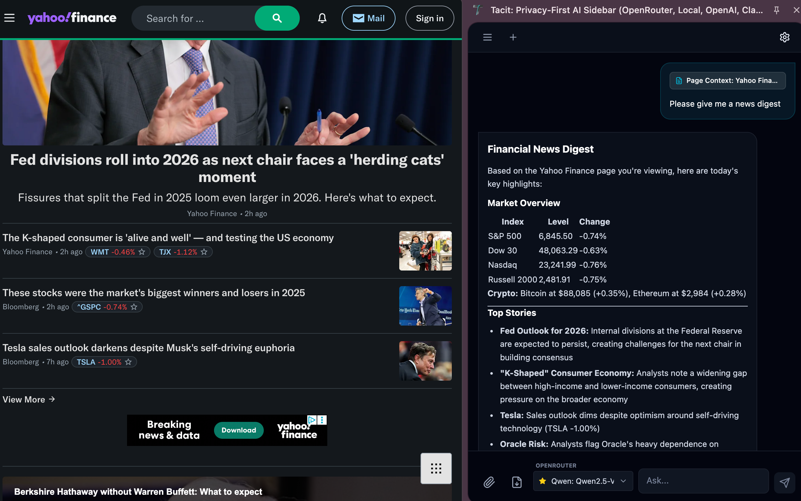
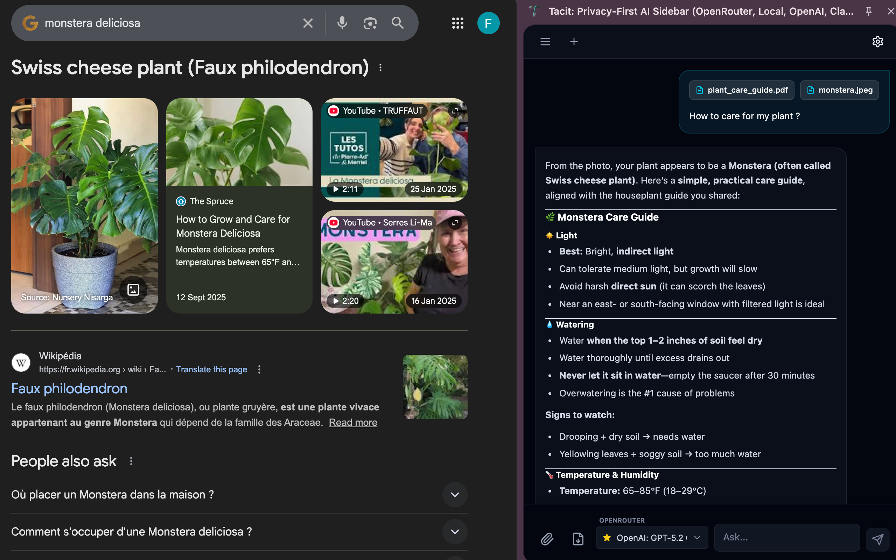
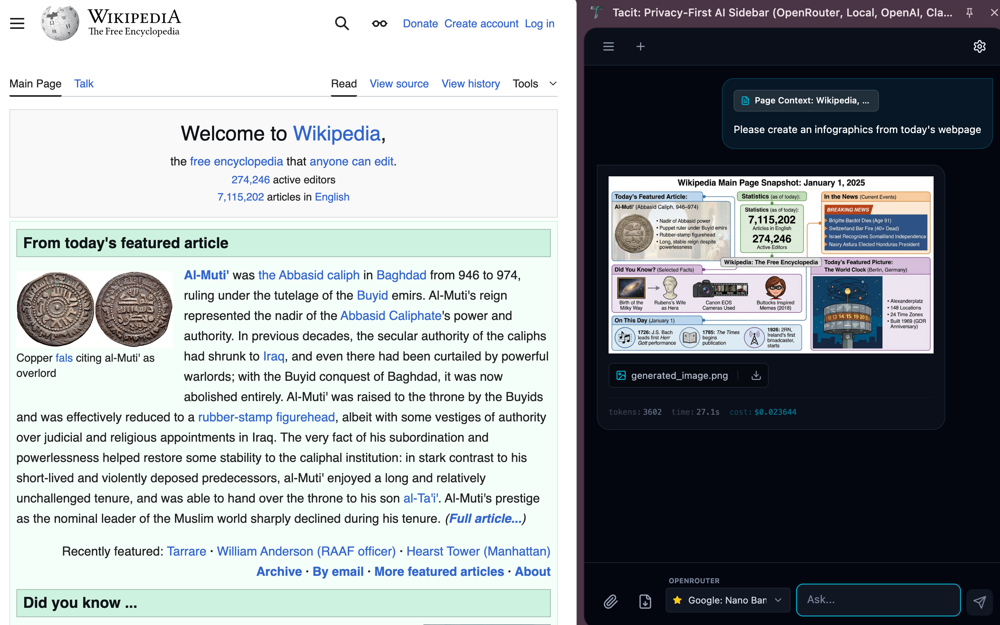
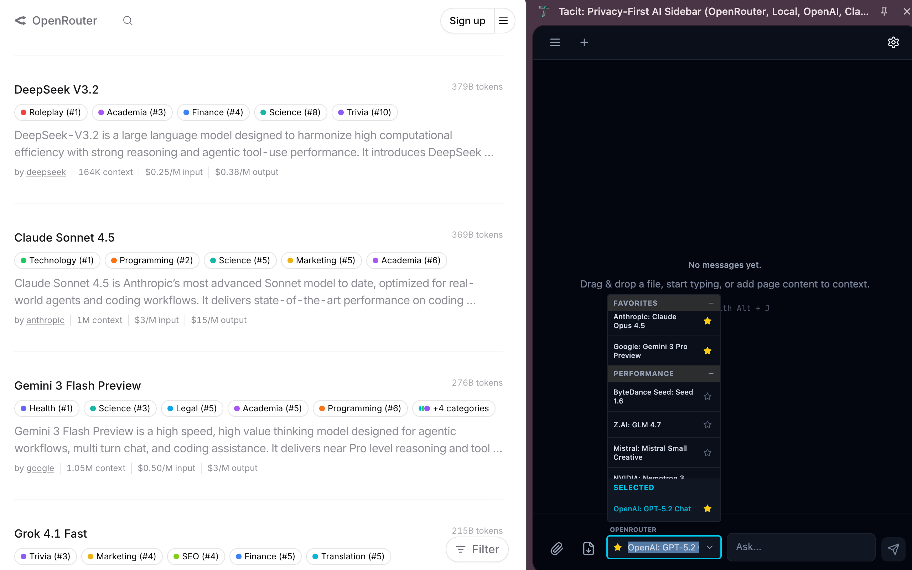

# Tacit: The Zero-Knowledge AI Sidebar

<div align="center">

[Chrome Web Store](https://chromewebstore.google.com/detail/tacit/ofkdnnmehcilcnogidbafddkdnojehea) | [Demo Video](https://www.youtube.com/watch?v=6cdTzj2b2KE)

</div>

<br />

<div align="center">
  
  
  <br/>
  
  
</div>

<br />

## 📜 Core Philosophy

**"The extension that knows nothing about you."**

Most AI browser extensions follow the same playbook:
1. Collect your data (to "improve the experience")
2. Mark up AI provider costs
3. Clutter your browser with features you didn't ask for

We built Tacit differently.

### Our Principles

### Zero-Knowledge Privacy
- **No backend servers**. We don't have a database. We literally *cannot* see your conversations.
- **Local-first storage**. Your history and credentials stay in your browser profile. API keys are encrypted. Optional history encryption protects conversation titles, messages, metadata, and attachments after migration completes.
- **Price lookups**. To show prices and costs for OpenAI, Anthropic and Google models, Tacit downloads OpenRouter's public model list with an anonymous request.
- **Auditable code**. Open sourced on github.

### Zero-Markup Pricing
- **Bring Your Own Key (BYOK)**. Pay wholesale rates directly to OpenRouter, OpenAI, Anthropic, or Google.
- **Or pay nothing**. Run Ollama or LM Studio locally with zero API costs.
- **No subscription trap**. We'll never gate core features behind a paywall.

### Zero Clutter
- **No injected buttons** polluting your navigation.
- **No "AI Shopping Assistant"** or other gimmicks.
- **Just a sidebar**. Press `Alt+J`, ask your question, get your answer.

## ✨ Features

### ⚡ The Basics
- **Global hotkey**: `Alt+J` (or `Option+J` on Mac) slides the sidebar in from any webpage
- **Persistent chat history**: Saved locally, with optional background encryption
- **Works everywhere**: Lives besides your tabs, follows your browsing

### 🧠 Model Support
Connect to any of these:
- **Cloud APIs**: OpenRouter (hundreds of models, including vision models and Nano Banana Pro), Anthropic Claude, OpenAI GPT, Google Gemini
- **Local models**: Ollama and LM Studio with automatic CORS configuration
- **Smart defaults**: Tacit detects vision-capable models automatically

### 👀 What You Can Feed It
Feed it whatever you're working with:
- **"Read This Page"**: One-click to capture the current tab's text content
- **Drag-and-drop files**: 
  - Images → Vision analysis (screenshots, diagrams, memes)
  - PDFs → Full text extraction
  - Code/Markdown → Syntax-aware parsing

### 🌐 Web Search
Need answers about what happened yesterday? Enable web search.
- **Live Web Access**: Enable search to let the AI browse the internet for real-time info.
- **Stay Current**: Get answers about recent events beyond the model's training data.
- **Local model search**: Choose SerpApi, Serper.dev, or Brave in Settings → Local → Web Search Configuration. For Brave, enter a [Brave Search API key](https://api-dashboard.search.brave.com/) and select Save Search Config. The key is stored encrypted; queries are sent directly to Brave. Existing Google Custom Search configurations remain supported and editable.
- **LM Studio MCP search** (optional, LM Studio 0.4.0 or newer): Send web-search messages to LM Studio's native chat endpoint with an MCP search server you name; Tacit falls back to the built-in search if the endpoint is not available.

## ⚖️ How We Compare

| | **Tacit** | Typical AI Extensions |
|:---|:---|:---|
| **Your data** | Stays on your device | Sent to their servers |
| **Cost** | No subscription. Pay for what you use or nothing (Ollama/LMStudio). | $10–$30/month (marked up subscription) |
| **UI pollution** | Clean, minimalistic sidebar | Random UI elements |
| **Model choice** | Local models and hundreds of cloud models | Limited model choice |

## 🚀 Getting Started

### 📦 Install from Chrome Web Store

**[Chrome Web Store](https://chromewebstore.google.com/detail/tacit/ofkdnnmehcilcnogidbafddkdnojehea) | [Manual Installation](#developer-installation)**

### 💻 Developer Installation

If you prefer to build from source or contribute:

**Prerequisites**
- Node.js (v18+)
- npm or pnpm

**Steps**

1. Clone the repository
   ```bash
   git clone https://github.com/flecomet/tacit-sidebar.git
   cd tacit-sidebar
   ```

2. Install dependencies
   ```bash
   npm install
   ```

3. Build for production
   ```bash
   npm run build
   ```

4. Load into Chrome/Brave/Edge
   - Navigate to `chrome://extensions`
   - Toggle **Developer mode** (top right)
   - Click **Load unpacked**
   - Select the `dist` folder generated in the previous step.

## 🛠️ Configuration

Tacit works out of the box once you add an API key:

1. Open the extension (Alt+J).
2. Go to **Settings**.
3. **For Cloud Models**: Add an API key for OpenRouter, OpenAI, Anthropic or Google. Each provider can hold several labeled keys; the active key is chosen in Settings or at the top of the model picker.
   - **OpenRouter EU data residency**: when adding or editing an OpenRouter key, click "Use EU endpoint", or enter `https://eu.openrouter.ai/api/v1` as its endpoint. A second key without an endpoint uses the global API.
   - **OpenRouter model list**: the picker lists the models your key is authorized to use (OpenRouter's `/models/user` endpoint on the key's configured endpoint), so account privacy and provider settings are reflected. Without a key the list is empty, and there is no fallback to the public catalogue. Each key has its own list. Use **Refresh models** in the picker to reload it, or **Retry** after a failed load.
   - **Price filter**: the picker's Price chip selects one tier: All, Free, Budget, Mid, High or Unknown. A tier comes from the catalogue prices only, using a reference cost in USD for 10,000 input plus 2,000 output tokens: below $0.01 is Budget, below $0.10 is Mid, and $0.10 or more is High. Free means both text prices are zero. Models with a missing or invalid price, or with a non-zero extra charge (such as per-request or image pricing) alongside zero text prices, are Unknown. The sort row orders the list by price (cheapest first, unknown prices last), release date, or name; the choice is saved with the other settings, and Favorites first keeps favorited models above the rest.
   - **Limits of the filter**: tiers are an estimate for comparison. They do not cap total spending, and they do not change your OpenRouter privacy or provider settings. Tools and other charges may add costs.
   - **Choosing a model**: UpChat does not pick an OpenRouter model for you. If the selected model is no longer in the list, or none is selected, choose one in the picker before sending.
4. **For Local Models**: Ensure your local server is running (usually `http://localhost:11434` for Ollama or `http://localhost:1234` for LMStudio).

### History encryption

Open **Settings → History encryption** to enable local history encryption. A gray ring fills clockwise in cyan as initial history is verified. The shield appears after verification and removal of the application's older plaintext history values.

Migration runs in short background jobs while Chrome remains open, including when the sidebar is closed. It resumes after interruption. If activation was interrupted before the write switch, reopen Settings and enable it again. An error retains unverified source data and appears in settings, where migration can be resumed. New history writes use the encrypted repository after activation; changing models or refreshing their catalog does not re-encrypt unchanged history.

The automatic mode uses a per-installation key stored in the same browser profile. It does not protect against someone who obtains that profile. The shield covers current conversation history, including attachments, but excludes drafts and saved instructions. Removing old application values does not guarantee physical erasure from disk pages, system backups, or browser-profile copies. Some initial history remains plaintext until finalization completes.

The initial import reads the old history as one value. Large histories can briefly interrupt the panel during preparation; background conversion is paced separately. Concurrent panels refresh changed history, reject stale destructive edits, and retain unsaved additions for recovery.

Verification results and reproduction commands are recorded in [History encryption verification](docs/history-encryption-verification.md).

## 🏗️ Technical Architecture

Tacit is a "zero-server" application running entirely in the browser:

- **Frontend**: React + Vite
- **Styling**: TailwindCSS, scoped to the side panel (nothing is injected into host pages)
- **State**: Zustand for the sidebar, separate settings persistence, and a background-owned IndexedDB history repository after opt-in
- **Security**: 
  - AES-GCM (256-bit) encryption of API keys, with a per-installation key kept in extension storage. This prevents keys from appearing in plain text in storage; it does not protect against someone with access to your browser profile.
  - Optional history encryption uses authenticated binary AES-GCM records, revision checks, durable migration checkpoints, and bounded background jobs.
  - Strict CSP (Content Security Policy)
  - No `eval()`, no remote code execution

## 💰 Monetization

Tacit is free and open-source (AGPL-3.0). We're not adding subscriptions, ads, or selling data.

## 🤝 Contributing

Got an idea? Open an issue first so we can discuss it before you spend time coding.

## 📄 License

AGPL-3.0 © François Lecomte-Denis
